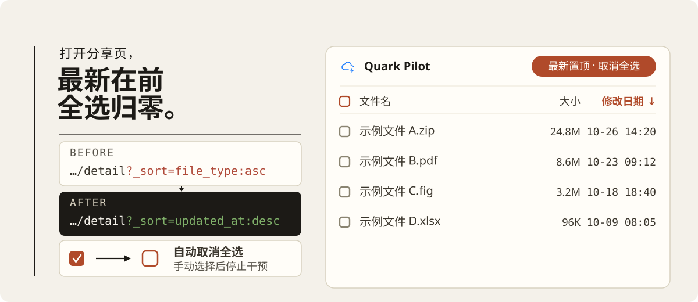

  

## 功能

- **最新文件优先**：文件按修改时间从新到旧排列。
- **取消默认全选**：分享页自动勾选全部文件后，脚本会取消选择。
- **保留手动选择**：用户点击任意复选框后，脚本不再取消全选。

## 工作方式

脚本在 `document-start` 时接管 `XMLHttpRequest.open`。当 `sharepage/detail` 请求携带默认排序 `file_type:asc,file_name:asc` 时，脚本将其改为 `updated_at:desc`。

列表内容连续 300 ms 没有变化时，脚本会检查顶部的全选框和全部文件。如果两者都已勾选，脚本点击顶部的全选框。用户点击复选框后，脚本停止自动取消全选。

## 致谢

- [夸克网盘-分享按时间倒序排序](https://greasyfork.org/scripts/530361)
